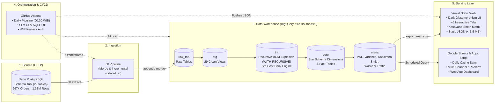
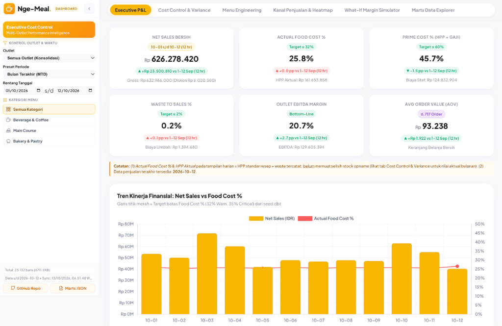
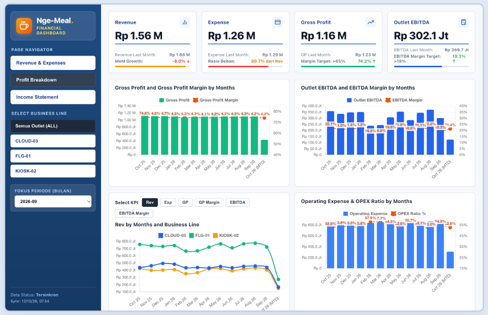

# F&B Data Platform

> **Enterprise-Grade Multi-Outlet Food & Beverage Data Platform built with Zero Operational Cost.**
> 
> Menggabungkan **Neon PostgreSQL (OLTP)**, **dlt (Ingestion)**, **Google BigQuery (`asia-southeast2`)**, **dbt Core v1.9 (Transformation & Semantic Costing)**, serta Serving layer ganda: **Vercel Static Dashboard (Chart.js + Kasavana-Smith Matrix)** dan **Google Sheets + Apps Script (Automated KPI & Alerts)**.

---

## Architecture Overview

Platform ini dirancang dengan prinsip **Keyless Security (WIF)**, **Strict Cost Guardrails**, dan **Idempotent Pipelines**.



---

## Dashboard & Serving Layer Showcase

Platform ini menyediakan antarmuka analitik ganda (*dual serving layer*) yang melayani kebutuhan operasional harian gerai hingga pelaporan keuangan eksekutif tanpa biaya server:

### 1. Multi-Outlet Performance Intelligence (Web Dashboard - Vercel)
Dashboard web interaktif (*client-side SPA*) berbasis HTML5, Vanilla CSS, dan Chart.js dengan konsumsi static JSON (< 5.5 MB):
- **Executive P&L & Cost Control**: Tracking metrik utama secara real-time seperti Net Sales Bersih, Actual Food Cost % vs Target (≤32%), Prime Cost % (HPP + Gaji), Waste-to-Sales %, Outlet EBITDA Margin, dan Average Order Value (AOV).
- **Tren Kinerja Finansial**: Grafik harian Net Sales vs Food Cost % terhadap batas ambang target (32% Warn, 35% Critical) dari seed dbt.
- **Dimensi Interaktif**: Filter konsolidasi atau spesifik per outlet (`Semua Outlet`, `FLG-01`, `KIOSK-02`, `CLOUD-03`), preset periode waktu (MTD/Custom), dan kategori menu.
- **Fitur Analitik Lanjutan**: Tab terintegrasi untuk Menu Engineering (Kasavana-Smith Matrix), Kanal Penjualan & Heatmap Traffic, What-If Margin Simulator, serta Marts Data Explorer.



### 2. Executive Financial Dashboard (Google Sheets & Apps Script)
Dashboard manajerial berbasis Google Sheets & Apps Script dengan sinkronisasi harian otomatis (*cached layer*) dari BigQuery:
- **Tinjauan Keuangan Eksekutif**: Monitoring performa finansial tingkat tinggi (Revenue, Expense, Gross Profit, Outlet EBITDA, Rasio Beban, dan Margin Target).
- **Tren & Analisis Bulanan**: Evaluasi histori Gross Profit Margin, EBITDA Margin, Operating Expense & OPEX Ratio bulanan, serta perbandingan revenue per business line.
- **Multi-Outlet & Periode Picker**: Navigasi halaman cepat (*Revenue & Expenses*, *Profit Breakdown*, *Income Statement*) dengan seleksi outlet dan fokus periode bulan.



---

## Zero-Cost Guarantee (100% Free-Tier Breakdown)

Seluruh komponen arsitektur berada dalam batas gratis permanen (*free-tier*) tanpa risiko timbul biaya - karena arsitektur ini hanya digunakan sebagai simulasi portofolio :

| Komponen | Provider | Batas Free-Tier | Konsumsi Platform Ini | Safety Mechanism |
|---|---|---|---|---|
| **OLTP Database** | Neon PostgreSQL | 0.5 GB storage, autosuspend | 324 MB (267k orders, 1.33M rows) | Auto-suspend compute saat idle |
| **Data Warehouse** | Google BigQuery | 10 GB storage, 1 TB query/bln | < 1.5 GB storage, ~80 MB per run | **Hard Quota 20 GB/hari** + `maximum_bytes_billed: 2 GB` |
| **Transformation** | dbt Core v1.9 | Open-source (Free) | Runs on GitHub Actions runner | Local execution / CI runner |
| **CI/CD & Scheduler**| GitHub Actions | 2,000 menit/bln (Public: Unlimited) | ~5 menit per daily run | Concurrency lock + timeout 30m |
| **Serving (Web)** | Vercel | 100 GB bandwidth/bln | ~5.16 MB static JSON bundle | Static-only hosting (no serverless compute) |
| **Serving (Alerts)**| Google Sheets & Apps Script | 6 menit execution/run | Sync run ~40 detik | Read-only cached tabs (no ad-hoc BQ queries) |

> **Kompensasi Keamanan Biaya:** BigQuery Query Quota disarankan diset via GCP Cloud Console ke **0.02 TiB/hari** (~20 GB/hari) dan seluruh query dbt/script dibatasi oleh flag `maximum_bytes_billed: 2000000000` (2 GB). Query apapun yang melebihi batas ini akan langsung di-abort otomatis oleh GCP sebelum dieksekusi.

---

## Fitur Analitik & Business Storytelling

Dataset mensimulasikan jaringan F&B multi-outlet (3 gerai: Flagship Sudirman `FLG-01`, Kiosk Dago Bandung `KIOSK-02`, dan Cloud Kitchen Kemang `CLOUD-03`) dengan cerita bisnis nyata yang tertanam:

1. **Kasavana-Smith Menu Engineering Matrix (`mart_menu_engineering`)**:
   - Kategorisasi menu otomatis: **Stars** (Margin Tinggi, Volume Tinggi), **Plowhorses** (Margin Rendah, Volume Tinggi), **Puzzles** (Margin Tinggi, Volume Rendah), **Dogs** (Margin Rendah, Volume Rendah).
2. **Rekonsiliasi Inventori Teoritis vs Aktual (`mart_inventory_variance`)**:
   - Membandingkan konsumsi resep standar (Theoretical BOM Explosion) terhadap hasil *Stock Opname* fisik bulanan.
   - Mendeteksi anomali nyata seperti *incident overpour susu* di KIOSK-02 (+6% takaran tanpa tercatat di POS) dan *spoilage* berkala pada bahan segar serta bakery di musim hujan.
3. **P&L Harian & Bulanan (`mart_pnl_daily`, `mart_pnl_monthly`)**:
   - P&L Harian berbasis *standard costing* untuk evaluasi cepat manajer gerai.
   - P&L Bulanan berbasis *actual cost of sales* (termasuk variance inventori, alokasi OPEX sewa, utilitas, gaji staf, perbaikan/pemeliharaan, dan pemasaran).
4. **Kinerja Channel & Potongan Komisi (`mart_channel_performance_daily`)**:
   - Transparansi margin antara transaksi *Dine-in/Takeaway* vs *Online Delivery* (GoFood 20% naik ke 22% per 2026, GrabFood 20%, ShopeeFood 18%).
5. **Traffic & Heatmap Operasional (`mart_orders_hourly`)**:
   - Pola lonjakan jam makan siang (11:00–13:00) dan makan malam (18:00–20:00) untuk optimasi jadwal staf barista & dapur.
6. **Recursive Bill of Materials (`int_item_explosion_daily`)**:
   - BOM diurai dengan `WITH RECURSIVE` sampai bahan raw, berapa pun tingkat prep-nya. Contoh dari story event 2026-11-01: `MNU_NGORENG → PRP_BUMBU (Bumbu Dasar) → PRP_BWGOR (Bawang Goreng) → ING_SHALLOT`. `loss_pct` dikalikan di setiap level, dan versi resep dipilih per tanggal.
   - **Fail loud, bukan silent**: prep tanpa resep aktif, siklus BOM, atau kedalaman di atas `bom_max_depth` tidak dibuang diam-diam. Porsi tersebut keluar dengan `ingredient_id = NULL` lalu menggagalkan test `not_null` dan `n_components_missing_cost`.
   - **Unit test rekursi di BigQuery**: BigQuery hanya mengizinkan `WITH RECURSIVE` di level teratas, sedangkan dbt membungkus SQL model di dalam subquery saat unit test. Override [`macros/unit_test_recursive.sql`](dbt/macros/unit_test_recursive.sql) mengangkat CTE `final` ke level teratas, sehingga 4 unit test (multi-level, modifier, prep tanpa resep, siklus) tetap berjalan.
7. **Incremental dengan Late-Arriving Data (`fct_order_lines`, `fct_orders`)**:
   - Sekitar 0,5% order offline baru tersinkron H+1 (1.339 order di data saat ini). Kedua fact memakai `insert_overwrite` per partisi `order_date`, dan partisi yang dibangun ulang dipilih dari **watermark `updated_at`**, bukan dari tanggal order. Artinya order yang terlambat berapa hari pun tetap masuk ke partisi tanggal aslinya, dan partisi itu dibangun ulang utuh sehingga tidak ada baris lama yang terhapus. `lookback_days` hanya berfungsi sebagai toleransi lag ingestion ([`macros/incremental.sql`](dbt/macros/incremental.sql)).
   - **Pengaman**: (1) pre-hook `guard_incremental_relation` menghentikan run bila partition spec tabel berubah. dbt-bigquery tidak memeriksa hal ini di jalur incremental, padahal target ber-partisi bulan yang ditimpa per hari bisa kehilangan data. (2) Test `assert_incremental_facts_in_sync` memastikan setiap order/item di staging ada di fact dengan versi terbaru. (3) Full refresh mingguan setiap Senin menangani perubahan retroaktif yang tidak menyentuh `updated_at`, misalnya koreksi standard cost.
   - **Biaya, apa adanya**: pada skala data ini incremental **tidak lebih murah** dalam byte yang ditagih (`fct_order_lines` 91 → 126 MiB, `fct_orders` 115 → 152 MiB per run). Penyebabnya, tabel raw dlt belum dipartisi sehingga filter `updated_at` tidak memangkas scan, ditambah biaya minimum 10 MB per tabel di script merge. Totalnya tetap di bawah 0,3 GB/hari, sekitar 1% dari free tier 1 TB/bulan. Penghematan nyata baru didapat setelah tabel raw dipartisi.

---

## Struktur Repositori

```
├── .github/workflows/
│   ├── daily_pipeline.yml       # Ingestion harian, dbt build, docs, export JSON
│   ├── pr_ci.yml                # Slim CI, SQLFluff linter, PII guard, CI teardown
│   └── wif_smoke_test.yml       # Verifikasi autentikasi Workload Identity Federation
├── infra/
│   ├── bootstrap_gcp.sh         # Script provisioning GCP idempotent (WIF, SA, dataset)
│   └── bigquery_setup.sql       # DDL dataset, WIF grant, PII salt secret
├── oltp/
│   ├── schema/
│   │   ├── 001_schema.sql       # 29 tabel DDL relasional (fnb schema)
│   │   ├── 002_seed_master.sql  # Master outlets, ingredients, menu, BOM recipes
│   │   └── 004_multilevel_bom.sql # Migration: BOM 3 level (Bumbu Dasar → Bawang Goreng), berlaku 2026-11-01
│   └── generator/
│       ├── generate.py          # Generator data deterministik & idempotent
│       └── config.yaml          # Parameter demand, event, dan elastisitas harga
├── ingestion/
│   ├── pipeline.py              # Ingestion dlt Postgres -> BigQuery raw_fnb
│   └── requirements.txt
├── dbt/
│   ├── models/
│   │   ├── staging/pos/         # 29 views pembersihan tipe data & metadata
│   │   ├── intermediate/        # Recursive BOM explosion (WITH RECURSIVE) & daily standard costing
│   │   ├── core/                # Star schema (dim_*, fct_*)
│   │   ├── marts/               # Marts analitik P&L, KPI, Kasavana-Smith, Variance
│   │   └── exposures.yml        # Lineage exposure ke Vercel & Google Sheets
│   ├── seeds/                   # kpi_thresholds.csv, id_calendar_events.csv
│   ├── tests/                   # Singular data tests (reconciliation & business logic)
│   └── requirements.txt         # dbt-core, dbt-bigquery, sqlfluff
├── dashboard/
│   ├── export_marts.py          # JSON exporter aman (PII masked, key filtered)
│   ├── vercel.json              # Konfigurasi routing Vercel
│   └── public/                  # Static SPA (HTML5, Vanilla CSS dark glassmorphism, JS)
│       ├── index.html
│       ├── style.css
│       ├── app.js
│       └── data/*.json          # Snapshot data mart publik
├── apps_script/
│   ├── Code.gs                  # Sync BigQuery -> Sheets, deduplicated alert email
│   ├── Dashboard.html           # Embedded Google Sheets web app
│   └── appsscript.json          # Manifest OAuth scopes & BQ Advanced Service
├── docs/
│   └── images/                  # Preview tangkapan layar antarmuka dashboard
└── scripts/
    ├── check_pii_columns.py     # Linter PII otomatis pada model YAML & JSON ekspor
    └── reconcile_neon_bigquery.py# Verifikasi 100% konsistensi row count OLTP vs DWH
```

---

## Kamus Tag dbt (`dbt tags`)

Gunakan tag dbt untuk menjalankan sub-DAG secara modular dan hemat resource:

| Tag | Deskripsi | Model yang Terkena | Contoh Perintah |
|---|---|---|---|
| `daily` | Model yang wajib diperbarui pada pipeline harian | `staging`, `intermediate`, `core`, `mart_pnl_daily`, dll. | `dbt build --select tag:daily` |
| `finance` | Seluruh model mart keuangan | `mart_pnl_daily`, `mart_pnl_monthly`, `mart_kpi_monthly_status` | `dbt build --select tag:finance` |
| `operations` | Seluruh model mart operasional gerai | `mart_inventory_variance`, `mart_waste_analysis`, `mart_menu_engineering`, `mart_channel_performance_daily`, `mart_orders_hourly` | `dbt build --select tag:operations` |
| `mart` | Seluruh tabel mart analitik akhir | Semua model di `models/marts/` | `dbt build --select tag:mart` |
| `staging` | Layer staging (views) | 29 models di `models/staging/pos/` | `dbt run --select tag:staging` |
| `core` | Layer dimensi dan fakta bintang | Dimensi & fakta di `models/core/` | `dbt build --select tag:core` |

---

## Keamanan & Good Practices

- **Zero Hardcoded Secrets**: Tidak ada file service account JSON key di repositori maupun GitHub Secrets. Seluruh autentikasi GitHub Actions menggunakan Google Cloud Workload Identity Federation (WIF).
- **Automated PII Guard**: Kolom pelanggan sensitif (`full_name`, `phone`, `email`, `address`) otomatis di-masking/hashing via macro dbt dan divalidasi oleh `check_pii_columns.py` sebelum di-publish.
- **Slim CI PR**: Setiap Pull Request memicu workflow `pr_ci.yml` yang menjalankan SQLFluff linter, PII guard, serta membangun hanya model yang berubah (`state:modified+`) pada dataset sementara `dbt_ci_pr<PR_NUMBER>_*` yang otomatis dihapus setelah pengujian selesai.

---

## Lisensi
Platform data ini dilisensikan di bawah [MIT License](LICENSE).
Dikembangkan untuk kebutuhan portofolio arsitektur data modern end-to-end berbiaya Rp 0.
